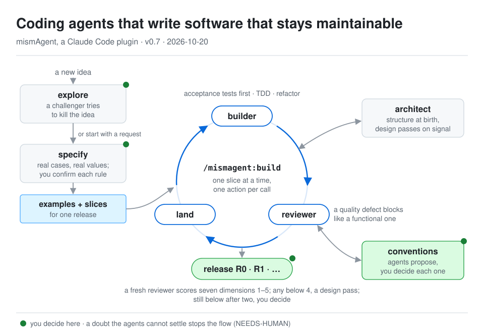

# mismAgent

**A Claude Code plugin that guides coding agents to write software that stays maintainable.**



## Start here

Requires Claude Code and **Python 3** (standard library only) for the tool `mm` and the hooks.
Optional: the [Serena](https://github.com/oraios/serena) MCP server — when it is installed, the
architect, builder and reviewer read (and the builder edits) code by symbol; without it they use
Read/Grep. The
repo root is the marketplace; register it with an **absolute path**:
```
/plugin marketplace add /absolute/path/to/this/repo
/plugin install mismagent@mismagent-method
/reload-plugins
```
Claude Code only for now: the Codex and pi packagings are suspended in
[`attic/ports/`](attic/ports/) (the conductor relies on hooks, `/loop` and `SendMessage`).

Then, for a new product: `/mismagent:explore <idea>`, `/mismagent:specify R0`, and
`/mismagent:build` until it stops for you. For a change: `/mismagent:specify <request>`, then
`/mismagent:build`. For a bug: `/mismagent:specify bug <what happens>`, then `/mismagent:build`.

## Why

A single agent, given a small well-described problem, already delivers the features: in our
baseline, plain Claude Code built a cash register, a change request and a second feature in fifteen
minutes, passing 40/40 of an external acceptance. What it loses is what the text did not
ask for: refactoring, design, exploration, coherence across sessions — and on long projects that
loss compounds. mismAgent is for that: maintainable code, exploration, existing code, coherence
from the architecture to the code, light by default.

The thesis: **the code carries the theory of the program** (Naur); **XP** keeps it clean (simple
design, test first, refactoring always); **the human agrees concrete examples**; the harness keeps
both honest. Heir of **BMad** and **Agentheim**.

## The commands

| You type | What happens |
|---|---|
| `/mismagent:explore <idea>` | For a new product: a dialogue on the problem → a one-page brief; a fresh-context challenger tries to kill it (you decide: stop, reshape, go on); an event storm of the domain — the timeline of events, who does what, what can be undone, the hotspots. |
| `/mismagent:specify <request>` | An interview, not a transcription: real cases with real values, the edges you would not volunteer, each rule restated for you to confirm. Out: the stack decision (first time), the release file, the examples (one file per capability), vertical slices for **one release only**. It closes only when the release holds together (`mm check --release`): every example in a slice, every slice proving an example, no open question. It runs beside a build in the same checkout: each file committed as it is written (`mm spec`), and a slice added to the release being built starts in its turn. |
| `/mismagent:specify bug <what happens>` | The short way: the bug reproduced in real values, found in the examples (a test too weak, a missing edge, or a wrong rule — then it is a change), one example and one `fix` slice. The builder proves it red before fixing it; it starts before any other slice. |
| `/mismagent:build` | **One action per call**, decided by the tool `mm`: build a slice (acceptance tests first, TDD, refactoring), review it on the review table, land it, run a design pass, or stop for you. Run it again, or under `/loop`. |
| `/mismagent:build --confirm R0` | Your confirmation of a release: the tag. Over a review that still has findings (`DESIGN-PASS`), `--why "…"`: your words are kept as a decision. |
| `/mismagent:conventions` | When the conductor stops for it (after the model slice, and after any slice that did something new): the agents' proposals as one table — you accept in one answer the ones recommended as they are, and decide one by one only those to reject, reword or that conflict — create or update a topic of the project's conventions skill (`.claude/skills/conventions/`), or reject it. |
| `/mismagent:site` | The project in the browser, read-only: the releases as swimlanes (to do · doing · done, foldable), each slice with its reviews, progress and commits, a slice built in a parallel worktree or branch among the doing ones; the requirements → examples → slices → acceptance tests; the conventions and decisions. The page is served live from a small local server (Python standard library, `127.0.0.1` only): it follows the project by itself while the builder works, and the conductor makes sure it is up whenever it stops for you. |
| `/loop /mismagent:build` (in a session of its own) | The always-on conductor: every action as soon as it is ready — build, review, land, design pass; when it needs you it waits and checks back every ten minutes, and resumes by itself once you have answered. Meanwhile `/mismagent:specify`, in another session, adds to the same release. |

You step in for the challenger's verdict, the examples, the stack, the project's conventions, an
important doubt (`NEEDS-HUMAN`) and each release.

## How it holds quality
- **Structure at birth:** the architect writes `ARCHITECTURE.md` before the first slice — layering,
  one owner per table, the error policy — and wires the sensors (formatter, linter, thresholds,
  suppression count) into the gate.
- **Files short by construction:** `ARCHITECTURE.md` says what one file holds (a use case, an
  entity, a screen's state); a second thing is a second file. Adopting existing code, the architect
  takes that rule from the best-kept code, and a file holding several things is split along it by a
  design pass, never by line count. The specs too: a one-page brief rewritten in place, one file
  per release (scope, open questions), per capability (its examples), per decision, and each slice
  carries its own progress. Acceptance tests live where the build wants them (`acceptance:` in
  `CLAUDE.md`).
- **Conventions decided with you:** the model slice and every slice that does something new propose
  how code is written here; you decide each proposal, and the result is a project skill
  (`.claude/skills/conventions/`, rules with real files as examples) that the builder loads and the
  reviewer checks by. It grows with the code instead of being compacted.
- **Every slice:** acceptance tests at the use-case seam first, test-first to green, a refactoring
  pass, a commit at every green — green read from the exit code, never through a pipe (`mm gate`
  ends on its verdict, so even a `| tail` shows it); a fresh reviewer blocks a quality defect in the diff exactly like a
  functional one.
- **Every release:** a fresh reviewer runs the app and checks the code the release touched, and the
  paths it runs through, by the categories of the conventions skill — the gate really running each
  acceptance test (**tests**), every **cross-cutting** topic (errors, security, configuration, the
  composition root…) along one traced path with the files it read, the **local** kinds at the ten
  most-touched files — each finding on a dimension of the
  [review table](plugins/mismagent/skills/craft/references/review-table.md) (simple design, naming,
  modularity, duplication, concision, error handling, test quality), with its line, no scores; a
  decided deviation is not a finding. A look difference alone is no finding: the review counts the
  pairs that differ and you accept them at confirm with your reason (one an example quantifies
  still fails). With a finding, the architect reads the code and queues refactoring slices
  (structure only: a wrong result goes to the release's open questions, for `specify`). After one design pass, you decide: confirm with your
  reason, or ask for another. A release is reviewed and tagged only with no open question in its
  file and a `smoke:` to run the app. A wrong result noted outside a diff (`- RISK` in the design
  notes) holds the release review until a design pass turns it into a slice; left there, you decide.
- **Tools compute, agents judge:** `mm` owns the state, the git moves and every count. Agents
  signal through it, never by hand: `mm built` closes a builder's round with the gate run against
  the slice's `Base:` — the human's files untouched, the markers in place, the other examples' tests
  it touched listed for the reviewer — then `Built:` written; `mm review` writes the verdict lines
  and refuses when HEAD moved during the review; `mm tag` needs a review at HEAD. The commits `mm` later reads are
  `mm`'s own: `mm spec`, `mm conventions`, `mm designed` (a design pass, recorded even when it
  changed nothing) — no prompt asks an agent to type one, and a hook denies the three agents the
  literal command, as it denies them the `mm` subcommands of another role (it reads the command's
  text: a convention it backs, not a signature). In the folders two sessions write (decisions,
  slices in todo, release files, the map) those two commit the files their caller names, never the
  folder. A gate setting a slice changed in `CLAUDE.md` (a threshold, a command) is listed for its
  reviewer, and a slice's `Base:` is `mm`'s: a header that is no longer the one in the last commit
  that moved the slice from todo to doing turns the gate red. `suppress:` names the stack's own
  suppression markers, so `suppressions: 0` means it on Swift, Rust or TypeScript too. Every gate command
  runs under a `timeout:`, so a hung simulator never holds the conductor.
- **The map stays a map, the sensors prove the real app:** `ARCHITECTURE.md` says the code as it
  is now, by paths and symbols — a change of decision is a decision file, never a history in the
  map; `mm check` warns on a path no file or folder has, a `file:line`, a slice named, more than
  `max_map_chars` characters, and a slice that makes the map false is reworked. The smoke runs
  through the wiring the app's entry calls; the shot command drives it from outside the production
  views; a use case missing from the wiring fails at compile time or at startup, never in silence.
  A slice's screens stay on disk, never committed (`shots/.gitignore`, and `mm built` refuses one
  staged): only the set of a confirmed release goes to git at `mm tag`.

## The method's own log
Every builder round ends with one line on what in the *method* (never the code) slowed it —
`mm built --friction "<spec|tool|conventions|env|context|review>: <≤15 words>"`, or `none`, the
normal answer — kept in the slice file; a reviewer may add one to its review. `mm log [--release R]`
counts them, with the rounds, doubts and wall-clock of the landed slices read from git; the
conductor shows its totals at each confirm. **Read it at a release, with the counts: change the
method only for a category that recurs, naming the number the change should lower** — not a to-do
list of single entries (24 versions in 22 days was that). 0.7.25 is measured the same way
([plan](docs/rationale/v0.7.25-plan.md)). `mm built` also records the gate's seconds each round
(`Gate:`), which `mm log` reports: a faster gate is decided on that number. 0.7.26 comes from an
external architecture review of a 10k-line iOS app built with the method
([plan](docs/rationale/v0.7.26-plan.md)). 0.7.27 lets `/mismagent:specify` work beside the build loop in
the same checkout ([plan](docs/rationale/v0.7.27-plan.md)). 0.7.28 closes four defects a review
of the harness reproduced: a builder loosening its own gate, state read from hand-typed commit
subjects, a suppression sensor blind outside Python/JS/Go, gaps in the git guard
([plan](docs/rationale/v0.7.28-plan.md)).

## The design, in three layers
| file | layer |
|---|---|
| [`v0.5-vision.md`](docs/rationale/v0.5-vision.md) | stable: purpose, thesis, lineage, the four loops, quality as a fixed point |
| [`v0.5-hypotheses.md`](docs/rationale/v0.5-hypotheses.md) | every mechanism as a hypothesis, with the experiment that confirms or refutes it |
| [`v0.5-core.md`](docs/rationale/v0.5-core.md) | the minimal core, what this plugin ships |
| [`v0.5-derivation.md`](docs/rationale/v0.5-derivation.md) | non-normative: how we got here |

The design keeps the name 0.5; the plugin ships as **0.7.x**, because builds numbered 0.5.0 and
0.6.0 of the earlier flow still sit in Claude Code's plugin cache, which is keyed by version.

The v0.26 flow (explore → model → worker-composer, parallel building blocks) is retired to
[`attic/v0.26/`](attic/v0.26/).

## Working on this repo
- `python3 -m unittest discover -s plugins/mismagent/tools/tests` — the tool, the hooks, the prompts
  (readable frontmatter, real `mm` subcommands; no word caps).
- `bench/` — measuring the harness on the product, against a baseline: `converse.py` (a builder and a
  simulated user in turns), `scenarios/baseline/` (plain Claude Code, the design-pass experiment),
  `scenarios/long-horizon/` (four change requests: does the code stay maintainable?), `score.py`,
  `cost.py`, `run.py`.
- [`docs/known-issues.md`](docs/known-issues.md) — defects accepted for now, each with its fix.
- [`docs/one-page.svg`](docs/one-page.svg) is the page at the top: update it, and its date, whenever
  a command or the flow changes.
- `.claude/settings.json` refuses an agent's `git commit` without a `README.md` update —
  `[skip-readme]` in the message opts out when nothing a reader sees has changed.
